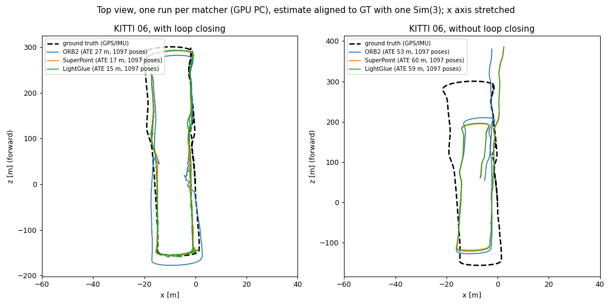
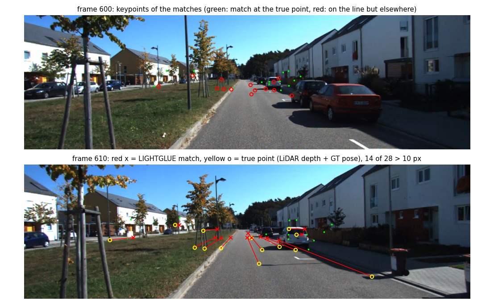
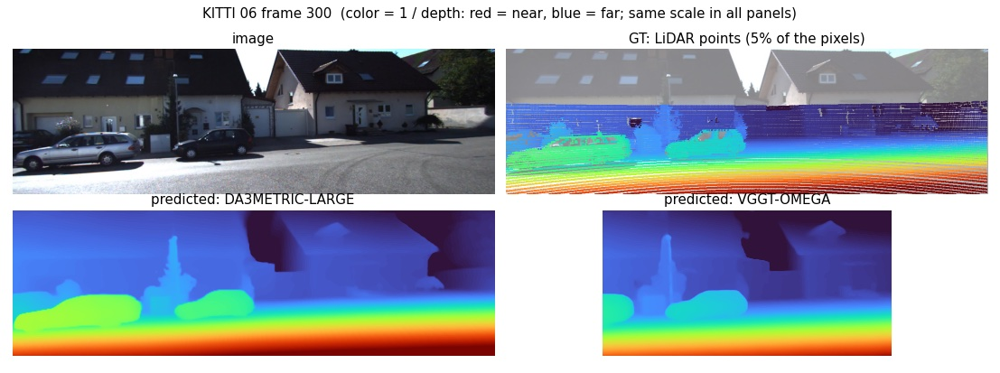

# WP1 – Results

All numbers come from one GPU PC (Radeon RX 9070 XT, WSL2). Raw outputs are in `results/` (not tracked); each
section names its run. Commands to reproduce: `README.md`.

## In short

1. **SLAM:** With loop closing all three matchers reach about 15 m error on KITTI 06 in their good runs. ORB varies
   most between runs (15 / 27 / 37 m); with 2–3 runs per matcher this is not a ranking. Without loop closing all
   three drift about the same (50–60 m): the learned matchers do not make the tracking itself more accurate here,
   and LightGlue loses tracking more often.
2. **Matching:** When the camera moves more between two images, the learned matchers keep 5–6× more matches than
   ORB, so the camera motion can still be estimated well.
3. **Hidden errors:** About one in five of their checked matches passes the usual check but is not at the true
   point (18–24 of 100; ORB: 5 of 100): the point is matched to the *next* tree or car in a row. Part of this is
   wrong LiDAR depth at the keypoint. Checked from both images, about one in eight matches is confirmed wrong
   (11–12 of 100; ORB: 2 of 100). This is the problem the project wants to solve.
4. **Depth from one image:** about 4–5 % off indoors, 7–10 % outdoors and 13–16 % outdoors at keypoints. Only DA3
   metric gives meters (7–10 % too small, almost constant: ± 5 % between frames).
5. **Local geometry:** indoors VGGT-Ω's surface normals are 2–3× more stable between two views than DA3's, and
   20–30 % more accurate against the Kinect. Outdoors, with more camera motion, all models' normals change by
   15–17° between the views; VGGT-Ω is only slightly better.

## 1. SLAM – how far off is the whole trajectory?

pySLAM on KITTI 06 (one camera, 1101 frames), 3 runs per matcher, with and without loop closing. Error = mean
distance to the true trajectory after aligning both (ATE).

| Matcher | Error with loop closing | Error without loop closing | Runs that lost tracking |
|---|---|---|---|
| ORB | 26 m (runs: 15 / 27 / 37) | 51 m | 0 of 6 |
| SuperPoint | 15 m (2 complete runs) | 61 m | 1 of 6 |
| LightGlue | 15 m (2 complete runs) | 59 m (1 complete run) | 3 of 6 |

**What this means**
- Without loop closing the trajectory drifts by 17–20 % of the distance driven, about equally for all three. Most
  of it is scale drift: one camera cannot measure distances. The rotation drift (~0.2° per 100 m) is also about the
  same, so locally the three matchers are equally accurate.
- Loop closing removes most of the drift. ORB varies most between runs (15 / 27 / 37 m): in the worst run the loop
  was closed late and the correction bent the trajectory.
- The error with loop closing does not rank the matchers: ORB's best run is as good as the others, and SuperPoint
  and LightGlue have only 2 complete runs each. Differences of a few meters need more runs (median of 5–10).
- LightGlue (and once SuperPoint) loses tracking at the same two spots: fast straight driving past hedges and
  foliage, where SuperPoint finds only few keypoints.

All numbers and notes

ATE RMSE [m] after Sim(3) alignment, mean ± std over the runs with all poses (~1097 of 1101):

| Matcher | With loop closing | Without loop closing |
|---|---|---|
| ORB2 | 26.3 ± 9.1 | 51.4 ± 2.8 |
| SuperPoint (BF) | 15.3 ± 1.2 (2 runs; 3rd loses tracking at frame 511, 850 poses) | 60.8 ± 0.7 |
| LightGlue | 14.6 ± 0.1 (2 runs; 3rd loses tracking at frame 388, 660 poses) | not comparable: 2 of 3 runs lose tracking at frame 393 / 512 for good; full run 59.0 |

RTE (relative trajectory error; rpg_trajectory_evaluation toolbox, lecture 10, Zhang & Scaramuzza 2018; sim3
alignment, sub-trajectories of 100–800 m): translation [% of the length] / rotation [deg / 100 m], mean ± std over
the same full runs:

| Matcher | With loop closing | Without loop closing |
|---|---|---|
| ORB2 | 10.9 ± 3.4 / 2.02 ± 2.24 | 17.4 ± 0.8 / 0.27 ± 0.03 |
| SuperPoint (BF) | 6.6 ± 0.5 / 0.18 ± 0.00 (2 runs) | 20.1 ± 0.2 / 0.22 ± 0.01 |
| LightGlue | 6.2 ± 0.0 / 0.20 ± 0.01 (2 runs) | not comparable; full run 19.8 / 0.21 |

- runs: `results/eval_2026_11_21-20_47_12/wp1_slam_kitti06`, `results/eval_2026_11_21-19_56_30/wp1_slam_kitti06_no_loop`;
  RTE: `results/wp1_slam_rte_2026_11_23-00_28_02` (the toolbox's ATE equals pySLAM's for all 18 runs)
- pySLAM Python core, front-end on the GPU; keyframes with loop closing: ORB2 ~330–370, LightGlue ~320,
  SuperPoint ~350
- every run with loop closing closes one loop, except the LightGlue run that loses tracking; ORB2 spread from one
  late closure (KF 964 instead of ~852): orientation errors up to ~27° along the whole route (5.2 deg / 100 m);
  the other two ORB2 runs: RTE 11.7 / 0.56 and 6.5 / 0.30
- translation RTE in mono is dominated by scale drift, which the loop correction (Sim(3)) removes; rotation RTE is
  scale-free and about the same with and without loop closing -> local front-end accuracy (3 runs only -> tendency)
- the toolbox starts a sub-trajectory at every pose and ends it within ±20 % of the length; the KITTI devkit starts
  every 10th pose at the exact length -> devkit translation values are 3–5 % higher, same ranking
- partial runs: RTE only over their tracked part (in `summary.csv`), another part of the route -> not comparable
- no loop closing: no relocalization in pySLAM -> tracking loss is final
- where tracking is lost (LightGlue frames 388 / 393 / 512, SuperPoint 511; logs `iteration_<k>/logs/log.txt`):
  straight road at ~52 km/h (fastest parts of the route) past hedges / foliage, at 512 in deep shadow; SuperPoint
  finds only ~700 of the 2000 requested keypoints there (~840 elsewhere; ORB2 always 2000) -> ~50 tracked map points
  per frame, at the loss < 20 (pySLAM minimum `kNumMinInliersPoseOptimizationTrackLocalMap`); the other runs pass
  the same frames narrowly -> borderline case, run-to-run variation (thread timing) decides; with loop closing the
  lost LightGlue run relocalizes only at frame 827 (back at a known place)
- `percent_lost` misses all of these (≤ 0.1 %) -> check the pose count; pySLAM's `table_rmse.csv` also averages
  partial runs (e.g. LightGlue without loop closing: 32.5)
- C++ core (pySLAM default) loses tracking on this machine in most runs (e.g. LightGlue 76, SuperPoint 133 of
  1101 poses); same with Ubuntu 24.04 (official pySLAM platform, gcc 13, Eigen 3.4), clang, Eigen 5,
  without `-march=native` and with `kTrackingWaitForLocalMappingToGetIdle` -> cause open (WP4)
- Python core needs a 3-line fix for LightGlue (two pySLAM bugs, still in upstream master): 0 matches -> empty
  float index array (tracking crashes, process hangs); triangulation fallback calls LightGlue without keypoints
  (local mapping drops the keyframe). Same error type as pySLAM issue #136 (fixed there only for stereo)
  -> fix in this branch (3 files, see `README.md`); only changes cases that crashed before

## 2. Matching – can the matcher find the same point in two images?

Image pairs from KITTI 06, 1 s apart (≈ 12 m driven), 110 pairs. Each match is checked twice: does it lie on the
line that the true camera motion allows (epipolar line), and, where LiDAR measured the depth, does it hit the true
3D point?

| Matcher | Matches per pair | Correct (line check) | Correct (true point) | Hidden errors, confirmed from both images | Pose accuracy (AUC@10°) |
|---|---|---|---|---|---|
| ORB | 39 | 91 % | 87 % | 2 % | 0.76 |
| SuperPoint | 191 | 84 % | 66 % | 12 % | 0.92 |
| LightGlue | 246 | 83 % | 62 % | 12 % | 0.93 |

Both "correct" columns on the same matches (those with a LiDAR point, 16–21 %). Hidden errors: matches on the line
that miss the true point in both directions (image 1 → 2 and 2 → 1), of the matches with a LiDAR point in both
images. Pose accuracy: 1.0 = every pair's camera motion recovered perfectly.

*Frames 600 → 610, LightGlue: red = match on the epipolar line but at the wrong place, yellow = true point. The
wrong matches sit on the trees, the curb and the parked cars: the next object of the row stands where the first one
stood 10 m earlier.*

**What this means**
- Learned matchers keep 5–6× more matches when the camera moves, so the pose stays accurate. ORB runs out of matches.
- About one in five of their checked matches lies on the epipolar line but not at the true point (18–24 of 100),
  which the usual check cannot see. A wrong LiDAR depth at the keypoint looks exactly the same, so the check also
  runs from the second image back to the first: 11–12 % of the matches on the line fail in both directions
  (ORB: 2 %). The true share lies between the two values.
- RANSAC keeps these matches too, because they fit the true motion. This is exactly what the project wants to fix
  with geometry.
- Indoors (TUM, handheld camera) these confusions almost vanish: the camera moves in all directions, so rows of
  identical objects rarely lie along the epipolar line.

All numbers and notes

KITTI 06, 110 pairs per gap (gap 1 / 5 / 10 = 0.1 / 0.5 / 1 s), run `results/wp1_matching_kitti06_2026_11_21-14_48_41`:

| Matcher | Gap | Matches | Precision | Inlier ratio | AUC@5° | AUC@10° | AUC@20° | ms |
|---|---|---|---|---|---|---|---|---|
| ORB2 | 1 | 370 | 0.99 | 0.80 | 0.59 | 0.77 | 0.88 | 42 |
| ORB2 | 5 | 90 | 0.92 | 0.75 | 0.83 | 0.91 | 0.96 | 43 |
| ORB2 | 10 | 39 | 0.81 | 0.69 | 0.67 | 0.76 | 0.84 | 43 |
| SuperPoint | 1 | 529 | 0.96 | 0.79 | 0.64 | 0.79 | 0.89 | 56 |
| SuperPoint | 5 | 269 | 0.80 | 0.61 | 0.83 | 0.92 | 0.96 | 56 |
| SuperPoint | 10 | 191 | 0.64 | 0.47 | 0.85 | 0.92 | 0.96 | 55 |
| LightGlue (pySLAM: 2 layers) | 1 | 557 | 0.97 | 0.78 | 0.63 | 0.79 | 0.89 | 67 |
| LightGlue (pySLAM: 2 layers) | 5 | 328 | 0.89 | 0.65 | 0.85 | 0.92 | 0.96 | 66 |
| LightGlue (pySLAM: 2 layers) | 10 | 246 | 0.77 | 0.53 | 0.86 | 0.93 | 0.97 | 67 |
| LightGlue full (9 layers) | 1 | 547 | 0.99 | 0.82 | 0.61 | 0.79 | 0.89 | 83 |
| LightGlue full (9 layers) | 5 | 335 | 0.95 | 0.72 | 0.86 | 0.93 | 0.96 | 87 |
| LightGlue full (9 layers) | 10 | 259 | 0.86 | 0.60 | 0.88 | 0.94 | 0.97 | 89 |

- precision: epipolar distance (GT pose) < 5 px in both images (upper bound, errors along the line undetected)
- LightGlue (pySLAM, 2 layers): more and more precise matches than SuperPoint + BF at the same keypoints
- LightGlue full vs pySLAM's 2 layers: more correct matches, the more the larger the gap (gap 5 +9.5 %, gap 10 +17 %),
  precision 0.95 / 0.86 instead of 0.89 / 0.77; pose AUC about the same (+0.00–0.02); +16–22 ms per pair
- gap 1: low AUC for all (small baseline -> translation direction poorly constrained), differences not meaningful
- ms: median per pair (detection in both images + matching, first pair untimed); networks on the GPU, ORB2 on the CPU
- ORB2 keypoints change slightly between runs (pySLAM extractor) -> ORB2 pose AUC changes by up to ~0.07 (gap 1) /
  ~0.02 (gap 5 / 10); SuperPoint, LightGlue and RANSAC are reproducible

Depth check on KITTI: precision of the same matches, epipolar check -> depth check (on the line *and* ≤ 10 px from
the true point from LiDAR depth + GT pose); only matches with a GT point. Run
`results/wp1_matching_kitti06_2026_11_23-16_08_08` (the other columns reproduce the run above, ORB2 within its
variation):

| Matcher | Gap 1 | Gap 5 | Gap 10 | Matches with GT point |
|---|---|---|---|---|
| ORB2 | 0.99 -> 0.97 | 0.95 -> 0.91 | 0.91 -> 0.87 | 33 / 25 / 16 % |
| SuperPoint | 0.97 -> 0.94 | 0.90 -> 0.82 | 0.84 -> 0.66 | 37 / 27 / 16 % |
| LightGlue (pySLAM: 2 layers) | 0.98 -> 0.93 | 0.90 -> 0.78 | 0.83 -> 0.62 | 38 / 32 / 21 % |
| LightGlue full (9 layers) | 0.99 -> 0.95 | 0.95 -> 0.82 | 0.90 -> 0.66 | 37 / 32 / 22 % |

- the difference = wrong matches that lie on the epipolar line (`precision_epi_on_depth - precision_depth`)
- gap 1: all lose 1.5–4.5 points -> mostly GT noise (median distance to the true point 1.2–1.5 px)
- gap 5 / 10: the learned matchers lose 9–13 / 18–24 points, ORB2 only 4 / 5; at gap 10 all learned matchers end at
  0.62–0.66 -> the precision lead of LightGlue full over pySLAM's LightGlue shrinks from 7 to 4 points
- ORB2 keeps only few, distinctive matches (39 at gap 10) -> few confusions, but too few matches for a good pose
- the lost matches are far from the true point (tens of px); GT noise on the line is 1–4.5 px (median) -> 10 px
- pose AUC stays high at gap 10 (0.85–0.88) although 34–38 % of the checked matches are wrong: wrong matches on the
  line fit the true motion -> RANSAC keeps them as inliers
- GT point only where LiDAR exists in both images (lower image part, ≤ 80 m): road, cars, trunks, lower facades;
  16–38 % of the matches -> not a random sample

Depth check in both directions (same run): a wrong LiDAR depth at the keypoint (sparse LiDAR at object borders)
moves the true point along the epipolar line, like a wrong match, but only in the direction that uses this depth;
a wrong match misses the true point from both images. Share of the matches on the line that miss the true point,
image 1 -> 2 only -> in both directions; only matches with a GT point in both directions:

| Matcher | Gap 1 | Gap 5 | Gap 10 | Matches checked |
|---|---|---|---|---|
| ORB2 | 1.0 -> 0.8 % | 2.7 -> 1.9 % | 3.3 -> 1.8 % | 28 / 20 / 12 % |
| SuperPoint | 2.0 -> 1.6 % | 6.5 -> 4.3 % | 15.9 -> 11.8 % | 30 / 19 / 10 % |
| LightGlue (pySLAM: 2 layers) | 2.3 -> 1.7 % | 8.8 -> 5.0 % | 18.0 -> 12.3 % | 30 / 22 / 12 % |
| LightGlue full (9 layers) | 1.7 -> 1.3 % | 7.7 -> 3.7 % | 18.2 -> 11.3 % | 30 / 23 / 13 % |

- gap 5 / 10: a quarter to a half of the one-direction errors is not confirmed from the other image -> GT depth
  error at the keypoint, not a wrong match
- confirmed in both directions at gap 10: 11–12 % for the learned matchers, 1.8 % for ORB2 (6–7× fewer)
- the two-direction value is a lower bound (only 10–13 % of the matches have a GT point in both images, and these
  have the best LiDAR support); the one-direction value on all checked matches (table above, 18–24 points) is an
  upper bound, it counts GT depth errors as wrong matches

TUM fr1/desk (indoor, handheld; GT: mocap pose + Kinect depth), run
`results/wp1_matching_tum_fr1_desk_2026_11_22-23_51_08`, 56–57 pairs per gap, 30 fps (gap 5 / 10 / 20 =
0.17 / 0.33 / 0.67 s):

| Matcher | Gap | Matches | Precision | Depth check (same matches) | Inlier ratio | AUC@5° | AUC@10° | AUC@20° | ms |
|---|---|---|---|---|---|---|---|---|---|
| ORB2 | 5 | 161 | 0.88 | 0.92 -> 0.92 | 0.69 | 0.06 | 0.17 | 0.36 | 33 |
| ORB2 | 10 | 91 | 0.81 | 0.90 -> 0.89 | 0.66 | 0.19 | 0.36 | 0.53 | 32 |
| ORB2 | 20 | 43 | 0.63 | 0.84 -> 0.82 | 0.66 | 0.10 | 0.25 | 0.39 | 32 |
| SuperPoint | 5 | 305 | 0.85 | 0.91 -> 0.90 | 0.62 | 0.13 | 0.28 | 0.45 | 42 |
| SuperPoint | 10 | 252 | 0.77 | 0.88 -> 0.86 | 0.57 | 0.18 | 0.36 | 0.58 | 39 |
| SuperPoint | 20 | 166 | 0.64 | 0.82 -> 0.79 | 0.50 | 0.26 | 0.50 | 0.67 | 40 |
| LightGlue (pySLAM: 2 layers) | 5 | 321 | 0.86 | 0.91 -> 0.90 | 0.63 | 0.07 | 0.20 | 0.43 | 53 |
| LightGlue (pySLAM: 2 layers) | 10 | 278 | 0.79 | 0.87 -> 0.85 | 0.57 | 0.18 | 0.41 | 0.64 | 54 |
| LightGlue (pySLAM: 2 layers) | 20 | 211 | 0.69 | 0.82 -> 0.77 | 0.52 | 0.32 | 0.55 | 0.73 | 53 |
| LightGlue full (9 layers) | 5 | 296 | 0.88 | 0.93 -> 0.92 | 0.67 | 0.12 | 0.26 | 0.45 | 67 |
| LightGlue full (9 layers) | 10 | 252 | 0.83 | 0.91 -> 0.89 | 0.64 | 0.19 | 0.40 | 0.62 | 73 |
| LightGlue full (9 layers) | 20 | 199 | 0.74 | 0.86 -> 0.81 | 0.60 | 0.33 | 0.55 | 0.75 | 75 |

- depth check: matches with a GT point 64–77 % (Kinect holes, occlusions); loss only 0–5 points
- both directions (run `results/wp1_matching_tum_fr1_desk_2026_11_23-16_09_44`, the other columns reproduce this
  table, ORB2 within its variation): 0.4–2.2 % of the matches on the line miss the true point from both images
  (one direction: 0.4–4.4 %)
- GT noisier than on KITTI (fast handheld motion: blur, rolling shutter; RGB and depth up to 20 ms apart; mocap):
  median distance to the true point 2.7–4.3 px, precision at 5 px lower for all, gap 20 loss partly noise
- pose AUC low for all (AUC@5° 0.06–0.33): small baselines + GT noise -> compare matchers only within TUM; learned
  matchers: larger gap -> better AUC; ORB2 drops at gap 20 (43 matches)
- ranking as on KITTI: LightGlue full most precise (gap 5: tied with ORB2); best pose AUC at gap 20: both LightGlue

## 3. Depth – how good is the depth from a single image?

Three foundation models predict a depth map from one image. Compared with measured depth: Kinect indoors (TUM,
58 frames), LiDAR outdoors (KITTI, 111 frames). Error = average relative depth error after matching the overall scale.

| Model | Indoors | Outdoors | Outdoors, at keypoints | Real meters? |
|---|---|---|---|---|
| DA3 metric | 4.2 % | 8.8 % | 15 % | yes, 7–10 % too small (± 5 % between frames) |
| DA3 any-view | 5.3 % | 9.7 % | 16 % | no |
| VGGT-Ω | 4.1 % | 7.5 % | 13 % | no |

**What this means**
- Outdoors is about twice as hard as indoors, and keypoints are the hardest places (object borders, thin poles and
  branches). That matters, because matching happens exactly there.
- VGGT-Ω has the best shape. Only DA3 metric gives meters. Its error is almost constant (± 5 % between frames), so
  one correction factor per sequence removes most of it.
- Speed on the GPU: DA3 metric ~80 ms per image, VGGT-Ω ~250 ms.

All numbers and notes

AbsRel = mean |pred - GT| / GT, per frame median scale unless "metric":

| Dataset | Model | AbsRel all pixels | AbsRel ORB2 kps | AbsRel SuperPoint kps | AbsRel metric | δ < 1.25 | Scale GT / pred (cv) |
|---|---|---|---|---|---|---|---|
| TUM fr1/desk, indoor, Kinect, 58 frames | DA3METRIC-LARGE | 0.042 | 0.051 | 0.047 | 0.082 | 0.98 | 1.07 (0.05) |
| | DA3-LARGE-1.1 | 0.053 | 0.061 | 0.058 | – | 0.97 | not metric (0.35) |
| | VGGT-Ω | 0.041 | 0.046 | 0.045 | – | 0.98 | not metric (0.35) |
| KITTI 06, outdoor, LiDAR, 111 frames | DA3METRIC-LARGE | 0.088 | 0.149 | 0.150 | 0.128 | 0.92 | 1.11 (0.05) |
| | DA3-LARGE-1.1 | 0.097 | 0.156 | 0.161 | – | 0.90 | not metric (0.26) |
| | VGGT-Ω | 0.075 | 0.128 | 0.122 | – | 0.94 | not metric (0.23) |

- runs: `results/wp1_depth_tum_fr1_desk_2026_11_23-13_19_34`, `results/wp1_depth_kitti06_lidar_2026_11_23-13_56_18`
  (ORB2 keypoints vary slightly between runs)
- KITTI: middle 740 px (VGGT-Ω crops wide images, all models on the same pixels), LiDAR only in the lower image
  part, ≤ 80 m
- outdoor at keypoints ~1.7x worse than the image average (object borders, thin structures; LiDAR GT also noisy there)
- DA3 metric depth 6.5 % (indoor) / 9.6 % (outdoor) too small, stable over frames (cv 0.05)
- VGGT-Ω: no metric scale (changes 23–35 % between frames); DA3-LARGE-1.1 (any-view model, here one image per
  forward pass): weakest single-image depth of the three, no metric scale
- DA3 without the `f / 300` factor (pySLAM wrapper, `geomatch/depth.py`): TUM x1.45 too small, KITTI x0.97
- time per image (median, fp32): DA3 metric 72–91 ms, DA3 any-view 185–209 ms, VGGT-Ω 250 ms

## 4. Local geometry – is the surface direction at a keypoint reliable?

For each keypoint the surface normal (the direction the surface faces) is computed from the predicted depth with
Open3D's standard method (plane through the 30 nearest 3D points, Open3D's default). The same point seen in two
images must have the same normal once the camera rotation is taken into account. Pairs: TUM 0.33 s apart, KITTI 1 s
apart.

| Model | Normal change between two views: indoors | outdoors | Point moved with predicted depth, px off: indoors | outdoors |
|---|---|---|---|---|
| DA3 metric | 12.9° | 17.0° | 1.2 | 6.0 |
| DA3 any-view | 12.4° | 16.4° | 1.2 | 5.7 |
| VGGT-Ω | 5.1° | 14.6° | 1.1 | 3.2 |
| measured depth (Kinect) | 19.5° | – (LiDAR too sparse for normals) | – | – |

**What this means**
- Indoors VGGT-Ω's normals are 2–3× more stable than both DA3 variants. This holds for every neighbourhood size
  tested (30 / 100 / 300 points); larger neighbourhoods only make all normals smoother.
- Stable is not the same as accurate: a smoother depth map is more stable by itself. Against the Kinect normals
  VGGT-Ω is 20–30 % more accurate than DA3 (10.5° vs 13.0° / 14.7° with 300 neighbours), not 2–3×.
- Outdoors, 1 s apart, the normals of all models change by 15–17°; VGGT-Ω is still the most stable, but only by
  10–15 %. Normals of far-away outdoor surfaces from a single image are not reliable for any model.
- With 30 neighbours the Kinect's own normals are noisier than VGGT-Ω's, so a direct comparison with the sensor
  mostly measures sensor noise.
- Moving a point into the next image with the predicted depth works well indoors (about 1 px off for all models).
  Outdoors it is 3–6 px off, VGGT-Ω about half as far as DA3. Depth ratios between two images are most consistent
  when both images go through the model together.
- For WP2 / WP3: VGGT-Ω for patch normals (most stable indoors, somewhat more accurate); outdoors with larger motion do not rely on
  normals alone; depth from two or more images at once for depth comparisons.

All numbers and notes

- normals: Open3D `estimate_normals` on the back-projected depth map, k = 30 nearest 3D neighbours (Open3D
  default) in the tables; k = 100 / 300 for comparison (`normals_knn.csv`)
- ORB2 keypoints (SuperPoint: same trends, see `patch_summary.csv`), medians
- DA3-LARGE-1.1 (DA3 any-view) and VGGT-Ω: both images of a pair in one forward pass (common scale);
  DA3 metric: each image alone
- reproj.: keypoint back-projected with predicted depth, moved with the GT pose, px to the GT correspondence
  (aligned = depth scaled to GT per frame, metric = as predicted); KITTI: per-frame scale from all LiDAR pixels
  with a prediction (DA3: whole image, VGGT-Ω: middle 740 px only)

TUM fr1/desk (indoor, Kinect GT, 56–57 pairs per gap; run `results/wp1_depth_tum_fr1_desk_2026_11_23-13_19_34`):

| Gap (30 fps) | Model | Normal err. vs GT [°] | Cross-view normals pred [°] | Cross-view normals GT [°] | Reproj. aligned [px] | < 5 px | Reproj. metric [px] | Depth ratio err. |
|---|---|---|---|---|---|---|---|---|
| 5 | DA3 metric | 22.5 | 11.5 | 18.8 | 0.6 | 0.96 | 2.2 | 0.021 |
| 5 | DA3 any-view | 25.0 | 11.4 | 18.8 | 0.7 | 0.97 | – | 0.010 |
| 5 | VGGT-Ω | 18.5 | 4.8 | 18.8 | 0.6 | 0.98 | – | 0.012 |
| 10 | DA3 metric | 21.8 | 12.9 | 19.5 | 1.2 | 0.90 | 4.3 | 0.025 |
| 10 | DA3 any-view | 23.5 | 12.4 | 19.5 | 1.2 | 0.91 | – | 0.012 |
| 10 | VGGT-Ω | 17.6 | 5.1 | 19.5 | 1.1 | 0.94 | – | 0.017 |
| 20 | DA3 metric | 21.6 | 15.0 | 19.7 | 2.2 | 0.75 | 7.7 | 0.027 |
| 20 | DA3 any-view | 22.6 | 13.9 | 19.7 | 2.1 | 0.79 | – | 0.014 |
| 20 | VGGT-Ω | 17.2 | 5.6 | 19.7 | 2.0 | 0.83 | – | 0.020 |

Cross-view normals [°] by neighbourhood size k (TUM, ORB2; GT = Kinect normals, the noise floor of the GT):

| Gap | Model | k = 30 | k = 100 | k = 300 |
|---|---|---|---|---|
| 5 | DA3 metric | 11.5 | 9.3 | 7.1 |
| 5 | DA3 any-view | 11.4 | 9.5 | 7.1 |
| 5 | VGGT-Ω | 4.8 | 4.1 | 3.3 |
| 5 | GT (Kinect) | 18.8 | 12.3 | 7.2 |
| 10 | DA3 metric | 12.9 | 10.4 | 8.1 |
| 10 | DA3 any-view | 12.4 | 10.1 | 7.7 |
| 10 | VGGT-Ω | 5.1 | 4.4 | 3.6 |
| 10 | GT (Kinect) | 19.5 | 12.8 | 7.7 |
| 20 | DA3 metric | 15.0 | 12.6 | 9.8 |
| 20 | DA3 any-view | 13.9 | 11.6 | 8.8 |
| 20 | VGGT-Ω | 5.6 | 5.0 | 4.2 |
| 20 | GT (Kinect) | 19.7 | 13.4 | 8.3 |

- normal error vs Kinect (gap 10, k = 30 / 100 / 300): DA3 metric 21.8 / 17.0 / 13.0°, DA3 any-view 23.5 / 18.9 /
  14.7°, VGGT-Ω 17.6 / 13.3 / 10.5°; at k = 30 the Kinect noise dominates (its own cross-view consistency 19–20°)

KITTI 06 (outdoor, LiDAR GT, 110 pairs per gap; sparse LiDAR -> no GT normals; run
`results/wp1_depth_kitti06_lidar_2026_11_23-13_56_18`):

| Gap (10 fps) | Model | Points / pair | Cross-view normals pred [°] | Reproj. aligned [px] | < 5 px | Reproj. metric [px] | Depth ratio err. |
|---|---|---|---|---|---|---|---|
| 1 | DA3 metric | 439 | 4.9 | 0.7 | 0.95 | 1.3 | 0.027 |
| 1 | DA3 any-view | 439 | 4.6 | 0.7 | 0.95 | – | 0.019 |
| 1 | VGGT-Ω | 439 | 4.4 | 0.4 | 0.97 | – | 0.012 |
| 5 | DA3 metric | 210 | 11.6 | 3.0 | 0.62 | 5.5 | 0.048 |
| 5 | DA3 any-view | 210 | 10.8 | 2.9 | 0.65 | – | 0.029 |
| 5 | VGGT-Ω | 210 | 10.0 | 1.5 | 0.83 | – | 0.016 |
| 10 | DA3 metric | 106 | 17.0 | 6.0 | 0.46 | 9.6 | 0.068 |
| 10 | DA3 any-view | 106 | 16.4 | 5.7 | 0.47 | – | 0.045 |
| 10 | VGGT-Ω | 106 | 14.6 | 3.2 | 0.63 | – | 0.021 |

Cross-view normals [°] by neighbourhood size k (KITTI, ORB2):

| Gap | Model | k = 30 | k = 100 | k = 300 |
|---|---|---|---|---|
| 1 | DA3 metric | 4.9 | 4.3 | 3.8 |
| 1 | DA3 any-view | 4.6 | 4.0 | 3.5 |
| 1 | VGGT-Ω | 4.4 | 3.5 | 3.0 |
| 5 | DA3 metric | 11.6 | 10.5 | 9.6 |
| 5 | DA3 any-view | 10.8 | 9.8 | 9.0 |
| 5 | VGGT-Ω | 10.0 | 8.9 | 7.8 |
| 10 | DA3 metric | 17.0 | 15.6 | 15.0 |
| 10 | DA3 any-view | 16.4 | 15.6 | 14.3 |
| 10 | VGGT-Ω | 14.6 | 13.3 | 12.7 |

- outdoors the normals of all models get worse with the camera motion (4–5° at gap 1 -> 15–17° at gap 10); the
  ranking is the same for every k, but the lead of VGGT-Ω is small (10–15 %), unlike indoors (2–3×)
- points per pair drop with the gap (LiDAR coverage, occlusion check, VGGT-Ω crop)

- depth ratio between the views (needs a common scale: metric model or pair inference): TUM DA3 metric 2.1–2.7 %,
  DA3 any-view 1.0–1.4 %, VGGT-Ω 1.2–2.0 %; GT noise of the depth ratio TUM 0.7–1.2 %, KITTI 0.6–0.75 %
  -> indoors both pair-inference models are close to the GT noise
- pair inference or model? DA3 any-view uses the same pair inference as VGGT-Ω with the DA3 network: the common
  scale (depth ratio) comes from the pair inference, the local surface (normals) from the model
- metric reprojection (no GT scale) grows with the camera motion (DA3 scale error 6.5–9.6 %) -> WP3 thresholds have
  to grow with the motion, or the scale is estimated online
- KITTI gap 10: DA3 depth with the right scale puts a patch 6.0 px off (median) -> same size as the 6–7 px in
  `geomatch/demo.py`: depth accuracy at keypoints outdoors, not the `f / 300` factor (0.97 on KITTI)

## Open

Not done so far; possible next steps for WP2–WP4:

- **More than two images at once:** DA3 any-view and VGGT-Ω can process several images together (common scale).
  Only pairs were tested; e.g. the last few keyframes at once might give more consistent depth, but slower.
- **DA3MONO-LARGE:** a third Depth Anything 3 variant (one image, no meters). Supported in `depth_models.py`, not
  evaluated.
- **Confidence maps:** DA3 and VGGT-Ω also return a confidence per pixel (`depth_models.py` passes it on). Not
  evaluated; whether it predicts the depth error matters for uncertainty-aware filtering in WP3.
- **More SLAM runs:** 3 runs per matcher are too few to rank the matchers with loop closing; median of 5–10 runs.
- **Harder image pairs:** at 1 s the pose accuracy of the learned matchers is already 0.92–0.93, so an improvement
  can hardly show there. Compare on the true-point check (both directions) or on larger gaps.
- **SLAM on TUM:** the SLAM baseline runs on KITTI only; TUM would need only a config, no new code.
- **pySLAM's C++ core:** loses tracking on our PC (cause open), so the SLAM numbers use the Python core. Not tested
  on a Linux PC without WSL or with an NVIDIA GPU.

Machine

GPU PC: Ryzen 7 5800X3D + Radeon RX 9070 XT, Windows 10 + WSL2 Ubuntu 26.04, ROCm 10.2 (torch 2.15, GPU seen as
`cuda`), OpenCV 4.13 (from source), Python 3.11. SuperPoint / LightGlue / depth models on the GPU; depth models in
fp32 (no fast fp16 / bf16 kernels for this GPU under WSL, `DEPTH_FP32`).

